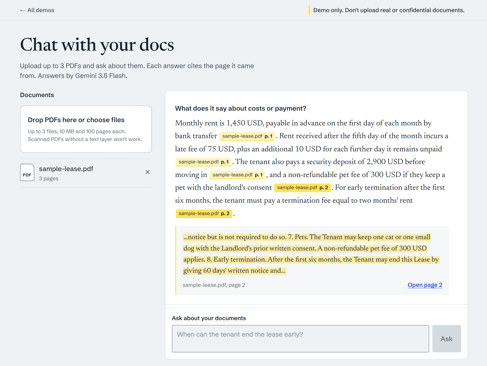
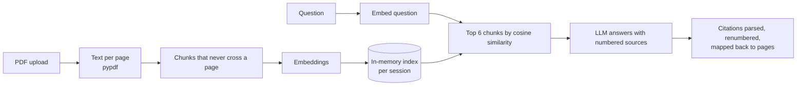
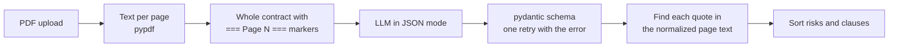
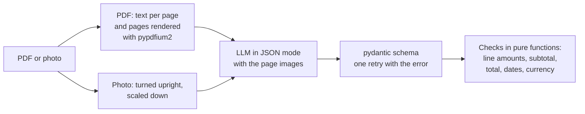

# AI demos

Small, working examples of AI features added to ordinary web apps, built by [Mohamed Rafeeh Ibrahim](https://www.linkedin.com/in/pomagom13/).

| Demo | What it does | Status |
|---|---|---|
| **Chat with your docs** | Upload PDFs and ask questions. Every answer cites the document and page it came from. | Live |
| **Contract reviewer** | Pulls out key clauses, dates and risks, each with a quote from the contract. | Live |
| **Invoice → JSON** | Turns invoices and receipts into structured data with a CSV export, and checks that the numbers add up. | Live |

<!-- Screenshot: add docs/screenshot-chat.png and uncomment.

-->

## Chat with your docs

A visitor uploads up to three PDFs and asks questions in plain language. The answer is written only from the uploaded documents. Each claim carries a citation chip, and selecting a chip shows the quoted passage and opens that page of the PDF. When the documents don't contain the answer, the app says so instead of guessing.

### How it works



- **Page-accurate citations.** Chunks never span two pages, so every citation points at exactly one page. The model cites numbered sources, and the backend drops any citation that doesn't match a retrieved source.
- **Any OpenAI-compatible LLM.** The provider is three environment variables. The live demo uses Google Gemini's free tier, and the same code runs on OpenAI, Anthropic's OpenAI-compatible endpoint, or a local model server.
- **Model fallback.** `CHAT_MODEL` is a list. When one model is overloaded, retired or out of quota, the next one answers.
- **Built for free hosting.** State lives in memory per session with a TTL and a session cap, so the API fits in 512 MB. Uploads and questions are rate-limited per visitor.
- **No vector database.** A session holds at most a few hundred chunks, so a numpy matrix product is faster and simpler than running a separate service.

### Stack

| Part | Tech |
|---|---|
| Backend | Python, FastAPI, pypdf, numpy, httpx |
| Frontend | Next.js (App Router), TypeScript |
| LLM | Gemini via its OpenAI-compatible API (swappable) |
| Hosting | Render (API) and Vercel (frontend) |
| Tests | pytest (148 tests across the three demos, offline fake model), Vitest (44 tests) |

## Contract reviewer

A visitor uploads one contract PDF, or tries the built-in sample lease, and gets a structured review: a plain-English summary, the parties, a table of key terms, the risks ranked by severity, and the clauses grouped by topic. Every point carries a quote and a page number. The backend checks each quote against the document before the visitor sees it, and a quote it can't find is shown as unverified rather than as a citation. The review downloads as JSON.

### How it works



- **Checked quotes.** Quotes are matched after folding case, whitespace and curly quotes. A quote found on a different page moves to the nearest page where it appears. A quote found nowhere is marked unverified, and the UI says "Quote not found in document" instead of showing it.
- **No retrieval step.** A contract of up to 40 pages fits in one model call, and a reviewer has to read all of it anyway.
- **Strict output.** The reply is validated against a closed schema: clause kinds and severities are fixed lists. A malformed reply is retried once with the validation error, then reported as an error rather than shown half-parsed.
- **Shared core.** The PDF checks, model fallback chain, rate limit and error shape are the same code as Chat with your docs. Nothing is stored: the review is computed and returned in one request.

## Invoice → JSON

A visitor uploads up to five invoices or receipts, as PDFs or photos, or tries the two built-in samples. Each file becomes a card with the vendor, customer, number, dates, currency, line items, taxes and totals. The app then does the arithmetic itself and shows a passed, failed or skipped label for each check, so a misread digit is flagged instead of slipping into someone's books. The batch downloads as CSV, one row per line item, or as JSON.

### How it works



- **Checked numbers.** The model only copies what is printed. The backend works out whether each line is quantity times price, whether the lines add up to the subtotal, and whether subtotal minus discount plus taxes equals the total. A failed check names both numbers: "Lines add up to 25.95 but the subtotal says 26.95." The sample receipt has exactly that mistake.
- **No float rounding.** Money is `Decimal` on the backend and a string in JSON and CSV, so `0.1 + 0.2` is `0.3`. Each check allows 0.01 per summed term for rounding on the document.
- **Images go to the model.** Gemini reads the page images through the OpenAI-compatible `image_url` content part, plus the text layer when a PDF has one, so scanned PDFs and phone photos work too.
- **One file at a time.** The browser sends the batch one file per request, so one bad file doesn't sink the others and the free backend holds a single file in memory. Nothing is stored.

## Run it locally

You need Python 3.10+ and Node 20+.

**Backend:**

```sh
cd backend
python -m venv .venv
.venv/Scripts/pip install -r requirements-dev.txt     # macOS/Linux: .venv/bin/pip
cp .env.example .env                                  # then set LLM_API_KEY
.venv/Scripts/uvicorn app.main:create_app --factory --reload
```

A free Gemini key comes from [Google AI Studio](https://aistudio.google.com/apikey). To run with no key at all, start the backend with `LLM_PROVIDER=fake`.

**Frontend:**

```sh
cd frontend
npm install
echo "NEXT_PUBLIC_API_URL=http://localhost:8000" > .env.local
npm run dev                                           # http://localhost:3000
```

Leave `NEXT_PUBLIC_API_URL` unset to run the frontend against a built-in mock instead.

**Tests:**

```sh
cd backend && .venv/Scripts/python -m pytest
cd frontend && npm test && npm run lint
```

## Repository layout

```text
backend/          FastAPI app. core/ is shared by every demo; demos/chat_docs/, demos/contracts/ and demos/invoices/ are the demos
frontend/         Next.js app. / lists the demos; /chat, /contracts and /invoices are the demos
docs/api.md       HTTP contract between frontend and backend
docs/design.md    Data model, retrieval and citation design, limits
docs/contract-reviewer.md  Contract reviewer design and API
docs/invoice-extractor.md  Invoice → JSON design and API
render.yaml       Render blueprint for the backend
```

More detail is in [backend/README.md](backend/README.md) and [frontend/README.md](frontend/README.md).
