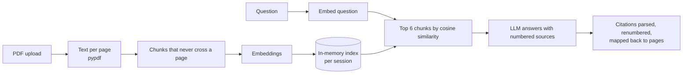

# AI demos

Small, working examples of AI features added to ordinary web apps, built by [Mohamed Rafeeh Ibrahim](https://www.linkedin.com/in/pomagom13/).

| Demo | What it does | Status |
|---|---|---|
| **Chat with your docs** | Upload PDFs and ask questions. Every answer cites the document and page it came from. | Live |
| Contract reviewer | Pulls out key clauses, dates and risks, each with a quote from the contract. | Coming soon |
| Invoice → JSON | Turns invoices and receipts into structured data with a CSV export. | Coming soon |

<!-- Screenshot: add docs/screenshot-chat.png and uncomment.

-->

## Chat with your docs

A visitor uploads up to three PDFs and asks questions in plain language. The answer is written only from the uploaded documents. Each claim carries a citation chip, and selecting a chip shows the quoted passage and opens that page of the PDF. When the documents don't contain the answer, the app says so instead of guessing.

### How it works



- **Page-accurate citations.** Chunks never span two pages, so every citation points at exactly one page. The model cites numbered sources, and the backend drops any citation that doesn't match a retrieved source.
- **Any OpenAI-compatible LLM.** The provider is three environment variables. The live demo uses Google Gemini's free tier, and the same code runs on OpenAI, Anthropic's OpenAI-compatible endpoint, or a local model server.
- **Model fallback.** `CHAT_MODEL` is a list. When one model is overloaded, retired or out of quota, the next one answers.
- **Built for free hosting.** State lives in memory per session with a TTL and a session cap, so the API fits in 512 MB. Uploads and questions are rate-limited per visitor.
- **No vector database.** A session holds at most a few hundred chunks, so a numpy matrix product is faster and simpler than running a separate service.

### Stack

| Part | Tech |
|---|---|
| Backend | Python, FastAPI, pypdf, numpy, httpx |
| Frontend | Next.js (App Router), TypeScript |
| LLM | Gemini via its OpenAI-compatible API (swappable) |
| Hosting | Render (API) and Vercel (frontend) |
| Tests | pytest (49 tests, offline fake model), Vitest |

## Run it locally

You need Python 3.10+ and Node 20+.

**Backend:**

```sh
cd backend
python -m venv .venv
.venv/Scripts/pip install -r requirements-dev.txt     # macOS/Linux: .venv/bin/pip
cp .env.example .env                                  # then set LLM_API_KEY
.venv/Scripts/uvicorn app.main:create_app --factory --reload
```

A free Gemini key comes from [Google AI Studio](https://aistudio.google.com/apikey). To run with no key at all, start the backend with `LLM_PROVIDER=fake`.

**Frontend:**

```sh
cd frontend
npm install
echo "NEXT_PUBLIC_API_URL=http://localhost:8000" > .env.local
npm run dev                                           # http://localhost:3000
```

Leave `NEXT_PUBLIC_API_URL` unset to run the frontend against a built-in mock instead.

**Tests:**

```sh
cd backend && .venv/Scripts/python -m pytest
cd frontend && npm test && npm run lint
```

## Repository layout

```text
backend/          FastAPI app. core/ is shared by every demo; demos/chat_docs/ is demo 1
frontend/         Next.js app. / lists the demos; /chat is demo 1
docs/api.md       HTTP contract between frontend and backend
docs/design.md    Data model, retrieval and citation design, limits
render.yaml       Render blueprint for the backend
```

More detail is in [backend/README.md](backend/README.md) and [frontend/README.md](frontend/README.md).
